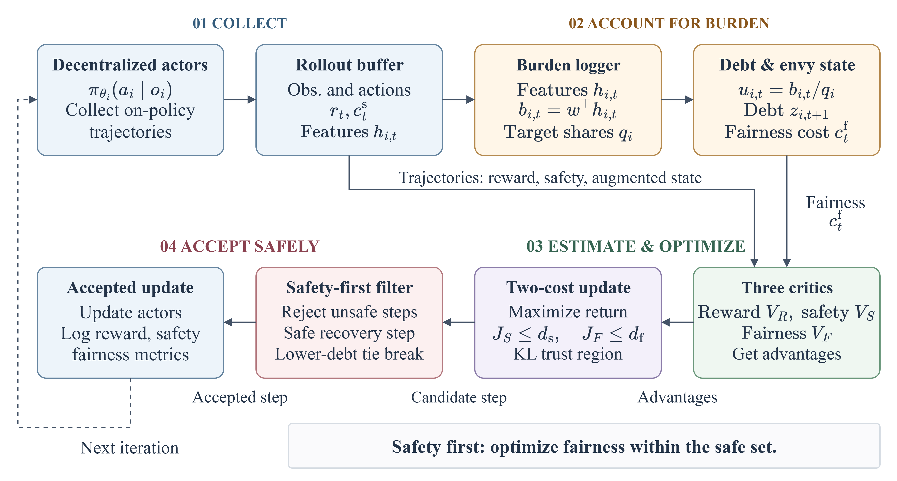

# Safe-Fair MACPO

Official reproducibility code for Safe-Fair MACPO, a constrained multi-agent reinforcement-learning method for long-horizon burden fairness. The repository contains the standalone trainer, experiment definitions, launch scripts, evaluation utilities, and table/figure generation code used by the paper.

**Authors:** Ankita Kushwaha, Kiran Ravish, Preeti, and Pawan Kumar.

This code release intentionally excludes generated results, checkpoints, simulator assets, and manuscript files. Every run writes to `safe_fair_macpo_runs/`, which is ignored by version control.

## Repository layout

- `codes/safe_fair_macpo_experiments.py` — trainer, task and method registries, fair-burden wrappers, evaluation, and manifest generation.
- `src/safe_fair_macpo/` — small installed package and command-line interface.
- `scripts/` — non-interactive environment setup and experiment launchers.
- `codes/` — evaluation, auditing, confidence-interval, and plotting utilities.
- `configs/` — fixed evaluation manifests used by the long-run workflows.
- `tests/` — fast unit tests for orchestration and artifact reporting.

## Architecture



*Safe-Fair MACPO architecture. Decentralized actors generate trajectories; agent-wise burdens update the recursive fairness-debt state; reward, safety, and fairness critics estimate their respective advantages; and a safety-slack gate restricts fairness-driven policy updates when safety constraints are not sufficiently satisfied.*

## Requirements

The supported setup is Linux with Python 3.10 or 3.11. Full MuJoCo experiments require a CUDA-capable machine, the simulator dependencies installed below, and enough storage for checkpoints. The built-in smoke environment can run on CPU and does not require external repositories.

The paper environment uses PyTorch 2.4.1. PyTorch is installed separately so that the CPU or CUDA wheel can be selected explicitly; all remaining Python dependencies are pinned in `requirements.txt` and `pyproject.toml`.

## Installation

Create a CPU environment for validation:

```bash
./scripts/bootstrap_env.sh
source .venv-sg/bin/activate
```

For CUDA 12.4, create the same environment with the matching PyTorch wheel:

```bash
SAFE_FAIR_TORCH_PACKAGE_SPEC=torch==2.4.1 \
SAFE_FAIR_TORCH_INDEX_URL=https://download.pytorch.org/whl/cu124 \
./scripts/bootstrap_env.sh
source .venv-sg/bin/activate
```

To use a different virtualenv location, set `SAFE_FAIR_VENV_DIR` consistently for setup and launch commands. If `uv` is unavailable, set `SAFE_FAIR_PYTHON_BIN` to a Python 3.10+ interpreter.

For full benchmark runs, install the pinned Safety-Gymnasium and MuJoCo dependencies:

```bash
./scripts/install_simulator_dependencies.sh
```

This network-enabled installer checks out Safety-Gymnasium at commit `ae966e511b9927f06b39c727ca5c650136a4e696`, verifies the exact revision, and stores it under the ignored `vendor/` directory. Other upstream baseline repositories are fetched only when `--clone-sources` is passed explicitly; all default CLI commands remain offline-safe.

## Quick validation

Generate lightweight experiment and environment manifests without training or network access:

```bash
./scripts/run_dry_run.sh --cpu
safe-fair-macpo status
safe-fair-macpo paper-matrix
```

Run the unit tests with the Python standard library:

```bash
python -m unittest discover -s tests -v
```

To train the built-in smoke task, which is not a paper result:

```bash
safe-fair-macpo train-quick --cpu
```

## Reproducing the experiments

Generate the complete experiment matrix after installing the simulator stack:

```bash
./scripts/generate_experiment_manifest.sh --clone-sources
```

The principal paper workflows are:

```bash
# Main seed-0 comparison and unconfounded controls
./scripts/run_seed0_core_matrix.sh
./scripts/run_unconfounded_baselines_seed0.sh

# Multi-seed promoted configurations and reproducibility evaluation
./scripts/run_multiseed_benchmark.sh
./scripts/run_reproducibility_workflow.sh

# SafeFairBench tasks and matched controls
./scripts/run_safefairbench_core_matrix.sh
./scripts/run_safefairbench_ablations.sh
./scripts/run_safefairbench_matched_recovery_controls.sh

# Workload-imbalance diagnostic
./scripts/run_workload_imbalance_study.sh
```

Long-running launchers are restartable at the artifact level: completed run directories remain under `safe_fair_macpo_runs/logs/`, and summaries can be regenerated from those logs. Run scripts from the repository root and do not combine rows from different code revisions in one result table.

The task/method matrix and seed counts can be inspected at any time with:

```bash
safe-fair-macpo paper-matrix
```

## Evaluation and uncertainty

Evaluate fixed checkpoints across seeds and stress modes:

```bash
python codes/eval_many_seeds.py \
  --manifest configs/evaluation_manifest_standard.yaml \
  --episodes 100 \
  --eval-seeds 0 1 2 3 4 5 6 7 8 9 \
  --out safe_fair_macpo_runs/tables/many_seed_eval.csv
```

Compute bootstrap confidence intervals and burden decompositions:

```bash
python codes/bootstrap_eval_ci.py \
  --input safe_fair_macpo_runs/tables/many_seed_eval.csv \
  --out safe_fair_macpo_runs/tables/eval_ci.csv

python codes/collect_burden_decomposition.py \
  --manifest configs/evaluation_manifest_standard.yaml \
  --episodes 50 \
  --eval-seeds 0 1 2 3 4 \
  --out safe_fair_macpo_runs/tables/burden_decomposition.csv \
  --fig-dir safe_fair_macpo_runs/figures/burden_decomposition
```

Audit result provenance before producing paper tables:

```bash
python codes/recompute_burden_summaries.py
python codes/audit_result_integrity.py
```

## Tables and figures

Regenerate aggregate tables and the safe/fair frontier from current local results:

```bash
python scripts/regenerate_result_tables.py
python scripts/generate_500k_comparison_table.py
python codes/plot_safe_fair_frontiers.py \
  --inputs safe_fair_macpo_runs/tables/main_results.csv \
           safe_fair_macpo_runs/tables/all_eval_rows_current.csv \
           safe_fair_macpo_runs/tables/ablation_results.csv \
  --out-dir safe_fair_macpo_runs/figures/frontiers
```

## Citation

If this code or method is useful in your research, please cite:

```bibtex
@inproceedings{kushwaha2026safefair,
  title     = {Safe-Fair {MACPO}: Burden-Fair Constrained Policy Optimization for Safe Multi-Agent Reinforcement Learning},
  author    = {Kushwaha, Ankita and Ravish, Kiran and {Preeti} and Kumar, Pawan},
  booktitle = {The Fortieth Annual Conference on Neural Information Processing Systems},
  year      = {2026},
  url       = {https://openreview.net/forum?id=Wff0AXdNL4}
}
```

## Reproducibility notes

- Training configuration, upstream source revisions, Python/PyTorch versions, device information, and task definitions are recorded in `safe_fair_macpo_runs/reproducibility_manifest.json`.
- Use the paper seed sets and fixed evaluation checkpoints for method comparisons. The smoke environment is only an installation check.
- Keep `safe_fair_macpo_runs/` and `vendor/` outside submission archives; both are generated locally.
- The package does not send metrics to external services unless `SAFE_FAIR_USE_WANDB=1` is set explicitly.
- External simulators and baseline repositories retain their own licenses. This repository is released under Apache-2.0; see `LICENSE`.
